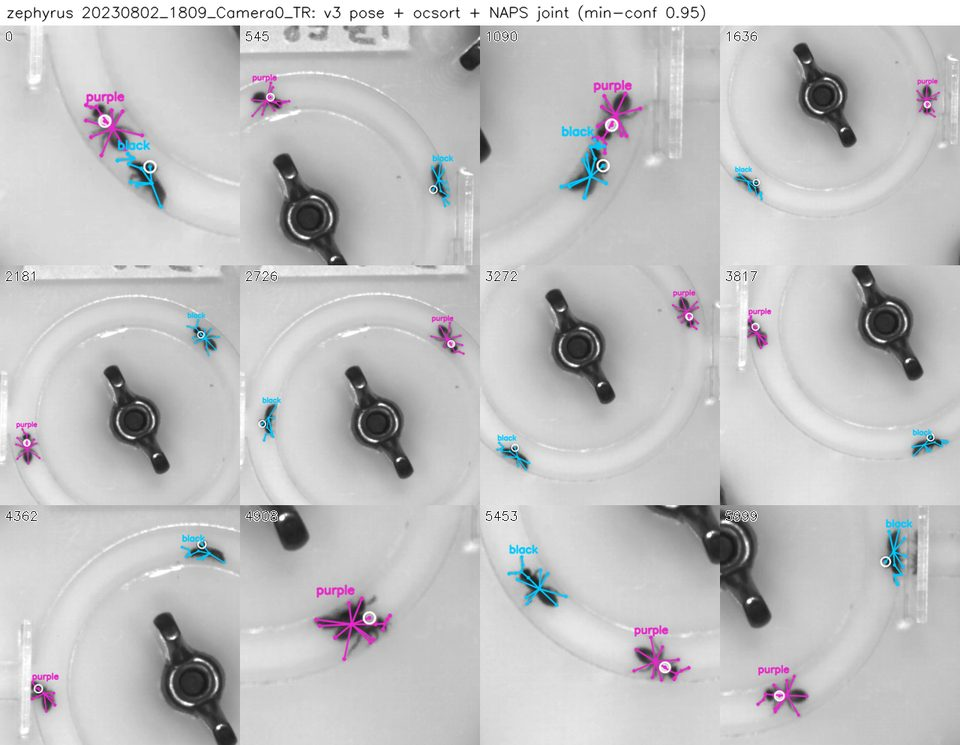
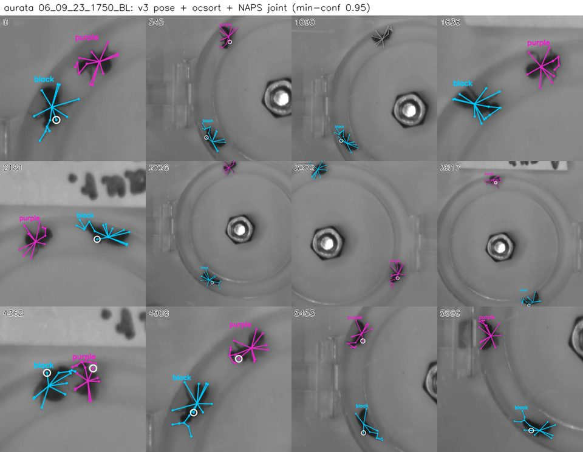

# Comparative pipeline (pose → identity → behaviour) for the circle-tube assays

This folder extends the *L. baleicum* circle-tube analysis to the other species (*A. aurata*,
*A. pura*, *L. zephyrus*, *L. melanderi*, *L. oenotherae* and the 2026 local recordings) and
replaces the tracking front end. It produces the **same per-video inputs as the analysis in this
repo** (`data/processed_data/interactions/`, `batch_degree/*_bouts.csv`, `velocities/*_vels.csv`;
tracks `ArUcoTag#black` / `ArUcoTag#purple`), so `scripts/R/` can run on every species.

What it changes relative to the original circle-tube processing:

| step | original (this repo) | here |
|---|---|---|
| pose | SLEAP 1.x per-species fine-tunes (silently trained from scratch) | one sleap-nn model on all species' labels |
| tag colour | `scripts/python/naps/classifier.pkl` (HistGradientBoosting) | per-video brightness threshold at the tag (videos are grayscale) |
| identity | `color_track.py` (rolling-window Hungarian) | NAPS joint engine, 2-bee closed set (`Wolfffff/naps`, branch `wolf-naps-colortag`) |
| trajectories | `filter_nodes.py` | `scripts/smooth_tracks.py` (keeps NAPS identities) |
| behaviour | `naps_interactions.py`, `analyze_network.py`, `culledvelocities.py` | `scripts/behavior.py` (same files, same interaction model `configs/interactions.yaml`) |

**Issues found in the original processing** (details in "Important findings" below):

- `scripts/python/select_color_tags.ipynb` (the colour classifier's training): the mask is never
  reset between clicked tags, so training rows are near-copies (315 distinct of 1,881) and the
  test split leaked them; training features (all disc pixels) differ from inference features
  (`color_tag.py`: half a square window without 255s); trained on ~640 px frame grabs, applied to
  1440 px video. On labelled LBAL frames it calls both bees "black" in ~70 % of pairs. The
  comparative runs used this `main`-branch classifier (md5 `73ea…`), not the retrained one on
  `sleap-retraining` (`af90…`).
- `filter_nodes.py` re-assigns identities by angle around the arena centre and can put both names
  on one bee: trajectories from it should not be used for identity-dependent analyses.
- `scripts/R/utils.R`: motion fraction uses only column 2 (one bee) and 0.0946 mm/px (LBAL rig).

| | |
|---|---|
|  |  |
| *L. zephyrus*: pose, OC-SORT tracks, NAPS identity (magenta = purple dot, blue = black dot; white ring = tag point) | *A. aurata* (out-of-focus video) |

`figures/tag_crops.png`: labelled tag crops per species (bright disc = purple dot; melanderi: both
bright). `figures/dark_oenotherae_session.jpg`: the 2026-06-22 session the first model missed.

---

Paired-bee arena videos (two bees, one with a light "purple" paint dot and one with a black dot)
→ **sleap-nn** top-down pose estimation and tracking → **NAPS** identity from the paint dots →
cleaned, smoothed per-bee trajectories. One `Snakefile` + `config/config.yaml` runs everything on
Della through SLURM.

## Quick start (Della)

```bash
git clone https://github.com/Wolfffff/lbal-circle-tubes.git && cd lbal-circle-tubes/comparative_pipeline   # on /scratch
curl -LsSf https://astral.sh/uv/install.sh | sh     # once, if you don't have uv
bash envs/setup.sh                                  # builds .venv-sleap, .venv-naps, .venv-smk (~10 min)

SMK=".venv-smk/bin/snakemake --profile profiles/della"
$SMK -n                    # dry run: what would run
$SMK evaluate              # train the model + held-out accuracy   -> results/v3/eval.tsv
$SMK                       # everything: every video of every dataset (+ QC tables)
```

Run the controller detached so it survives logout:
`setsid nohup $SMK > logs/snakemake.log 2>&1 &`. It submits SLURM jobs on account `skocher`
(change it in `profiles/della/config.yaml`). Everything is resumable: rerun the same command and
only missing outputs are made. To reuse already-trained models, copy `models/v3.*` into `models/`.

## What the pipeline does

| step | output (per video) | notes |
|---|---|---|
| pose + tracking (GPU) | `results/v3/<ds>/tracked/<video>.slp` | sleap-nn top-down model (centroid → centered instance), ≤ 2 bees, OC-SORT tracking |
| tag readings | `results/v3/<ds>/naps/<video>.decodes.npz` | brightness at the `tag` node of every bee in every frame |
| identity (NAPS) | `results/v3/<ds>/naps/<video>.slp` | tracks `ArUcoTag#black` / `ArUcoTag#purple`; `.identity.npz` = per-frame confidence, `.report.json` = summary |
| trajectories | `results/v3/<ds>/filtered/<video>.slp` + `.analysis.h5` | per identity: spikes removed, ≤ 10-frame gaps interpolated, 5-frame running median |
| behaviour | `results/v3/<ds>/behavior/<video>{.interactions.tsv,_hth_bouts.csv,_htb_bouts.csv,_vels.csv}` | same files as `lbal-circle-tubes` (Head_to_Head / Head_to_Body via `naps-interactions` + `configs/interactions.yaml`, bouts = frames ≤ 20 apart, per-bee speed) |
| tables | `results/v3/<ds>/behavior.tsv`, `qc.tsv` | per video: bout counts, speeds, motion fraction; bees/frame, tag found, identity coverage |

`.analysis.h5` is the SLEAP analysis format: `tracks` is (2 bees × 2 xy × 17 nodes × frames) and
`track_names` says which bee is which (h5py / MATLAB). Videos are processed in batches (10 per GPU
job, 12 per CPU job; `batch:` in the config), so a full run is ~50 SLURM jobs.

## Datasets (`config/config.yaml`)

| dataset | labels (corrected frames) | videos tracked | identity |
|---|---|---|---|
| `base` (*L. baleicum*, Japan 2023) | 1,687 | – (training only) | – |
| `aurata` | 60 | all in `comparative_behavior/aurata/input` | yes |
| `melanderi` | 60 | 80 listed in `lists/melanderi.txt` | **no** (see below) |
| `pura` | 60 | all | yes |
| `zephyrus` | 60 | all | yes |
| `oenotherae` | none | all | yes |
| `local_26` (2026 local) | none | 49 of 64 crops (`lists/local_26.txt`; 15 crops show no arena) | yes |

`local_26` is a mix of *A. aurata*, *A. pura* and *L. zephyrus*; the species and bee IDs on each
arena sticker are in `metadata/local_26_videos.tsv`.

**Add a dataset:** add an entry with `videos:` (directory of `.mp4`s) and optionally `labels:` (a
`.slp` of corrected frames, which then go into training) and `video_list:`.
**More training data:** correct frames in SLEAP, save the `.slp` into `labels/` and point the
dataset at it; `snakemake` retrains and re-evaluates.

## Results so far

Held-out accuracy of the current model (`v3`, `results/v3/eval.tsv`; px in 1440–1832 px frames):

| dataset | bees found | keypoint error (median) | tag-point error (median / 90th pct) |
|---|---|---|---|
| base | 98.8 % | 2.8 | 1.9 / 4.3 |
| aurata | 100 % | 4.7 | 2.8 / 13.9 |
| melanderi | 100 % | 3.7 | 1.4 / 3.2 |
| pura | 100 % | 3.4 | 1.4 / 2.9 |
| zephyrus | 100 % | 2.5 | 1.9 / 2.8 |

Only 12 held-out frames per new species, so the species rows are rough.

**Species without labels** (leave-one-species-out, `results/v3/loso.tsv`): on a species the model
has never seen, keypoint error roughly doubles (zephyrus 2.5 → 3.2 px, pura 3.4 → 6 px, aurata
4.7 → 8 px, melanderi 3.7 → 13 px) and it finds 84–100 % of bees; the 60 corrected frames bring it
back. For oenotherae, correcting ~60 frames is the most useful next step.

**Identity** (`snakemake identbench`): 20 % of the tag readings are withheld and NAPS has to infer
the identity there: 98.3 % (aurata), 100 % (pura), 99.4 % (zephyrus) correct, with 96–100 % of
bee-frames labelled (old `color_track` NAPS: 95.8 % on zephyrus, 88–99 % labelled).

## Important findings / changes from the old pipeline

1. **The old fine-tunes were never fine-tuned.** SLEAP 1.2.9 silently ignores `--base_checkpoint`,
   so the per-species models trained from random weights on 54 frames on CPU and the pose model
   collapsed (0 % keypoints → NAPS `ArUcoTag#None` → filter crash).
2. **The videos are grayscale.** The purple dot is a bright disc on the thorax; the black dot is
   nearly invisible. The old tag classifier (`classifier.pkl`) expected a much brighter purple and
   called *both* bees "black" in ~70 % of labelled *L. baleicum* frames. Identity now comes from the
   dot brightness (`naps-color-decodes`, per-video threshold), and NAPS's joint engine carries it
   along each bee's track (`--closed-set 0 1 --colony-size 2`, new in NAPS branch
   `wolf-naps-colortag`).
3. **The old `filter_nodes.py` discarded the NAPS identities.** It re-assigned the two names by
   angle around the arena centre (the first frame named the bees by angle order, so black/purple
   were arbitrary per video) and, on a pura test video, put *both* names on the same bee (median
   5 px apart). **Trajectories made with it should not be used for identity-dependent analyses.**
   It is replaced by `scripts/smooth_tracks.py`, which keeps NAPS's identities.
4. **Why the old classifier failed** (its training notebook is `lbal-circle-tubes/scripts/python/
   select_color_tags.ipynb`): the mask was created once per image, not per clicked tag, so the 10
   samples per image are near-copies (315 distinct of 1,881 rows, and the train/test split leaked
   them); training used all disc pixels while NAPS inference uses the upper half of a square window
   without 255s; and it was trained on ~640 px frame grabs but applied to 1440 px video.
5. **Behaviour outputs** reproduce the `lbal-circle-tubes` inputs (`interactions/`, `batch_degree/`
   bouts, `velocities/`) so the R analysis can run on every species. Differences: bouts are split per
   (origin, destination) pair, and speed is of the thorax for both bees, with columns in the order
   black, purple. The motion fraction uses `mm_per_px` (0.0946, the LBAL rig): measure it for each
   rig (`datasets.<ds>.mm_per_px`). Note: `utils.R` computes motion from column 2 only (the black
   bee).
6. **melanderi gets no identity.** Both of its tags read bright in the grayscale video, so
   brightness can't tell the two bees apart. Which tag colours were used for melanderi?
7. **Dark videos.** The base centroid recipe had no brightness/contrast augmentation; v3 finds no
   bees in the dark 2026-06-22 oenotherae session. `v3b` retrains the centroid with it.
8. One model for all species (sleap-nn, GPU), anchored on the thorax (labelled in 100 % of
   instances vs. 57–69 % for the tag), ±180° rotation and 0.8–1.25 scale augmentation, species
   frames oversampled 6× against the 1,518 base frames.

## Other targets

```bash
$SMK trackbench   # compare SLEAP trackers on 5-min clips   -> results/v3/trackbench/summary.tsv
$SMK identbench   # held-out identity test of NAPS settings -> results/v3/identbench/summary.tsv
$SMK loso         # leave-one-species-out models           -> results/<model>/loso.tsv
.venv-naps/bin/python scripts/render_preview.py --slp results/v3/pura/naps/<video>.slp \
    --video <video>.mp4 --out-png sheet.png --out-gif clip.gif   # look at predictions
```

Model variants live under `models:` in the config (`v4_unet`: wider UNets; `v4_convnext`:
ImageNet-pretrained ConvNeXt-Tiny); `infer_model:` picks the one used for the videos.

## Layout

```
Snakefile, config/config.yaml, profiles/della/   the workflow
envs/                 environment pins + setup.sh
labels/               corrected-frame .slp per dataset (video paths re-pointed to Della automatically)
lists/, metadata/     video lists; local_26 species per video
configs/              the original LBAL base model's SLEAP training configs (architecture recipe)
scripts/              train, evaluate, NAPS glue, smoothing, QC, benchmarks, rendering
scripts/legacy/       the old color_track NAPS + filter_nodes.py (comparisons only)
data/ models/ results/ logs/   generated (not in git)
```

## Known limits

- No human-checked identity ground truth: `identbench` scores NAPS against withheld tag readings,
  which are themselves ~95 % right on labelled frames.
- TensorRT export (4× faster inference) is wrong for this model type in sleap-nn ≤ 0.3.5; not used.
- The 4 `oenotherae` crops from 2026-06-22 11:22 include part of the neighbouring arena; check them
  before analysis.
